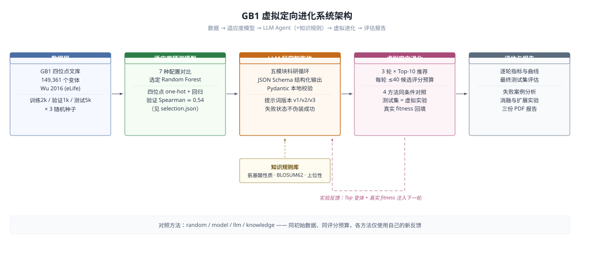
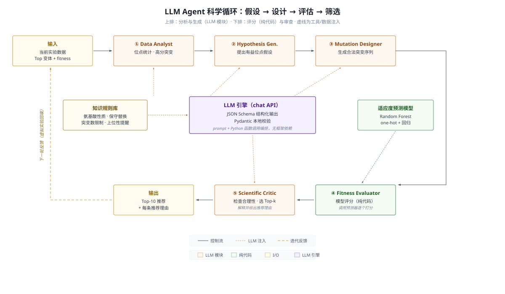
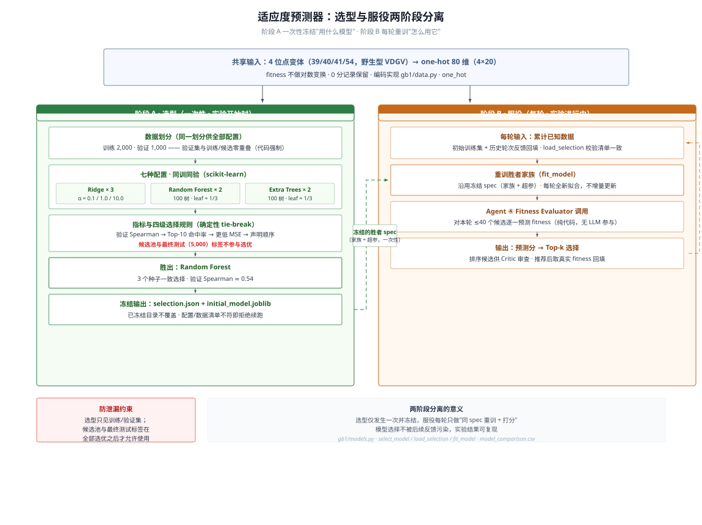

# GB1 虚拟定向进化实验

使用 GB1 四位点实验数据训练适应度模型，并比较随机推荐、模型推荐、LLM候选设计和知识增强候选设计。项目在 Windows / PowerShell 7 上运行；Python版本为3.12.14。当前DSH工作台版本为0.5.0，支持一键准备并运行、自定义实验参数、独立重复与批量比较。

## 从哪里开始

最简方式是在DSH“蛋白质进化”页面点击顶部“一键准备并运行”：自动准备项目依赖、下载并校验GB1官方S1、训练模型，然后按推荐Sol-xhigh/C40/k10/3轮运行。已注册的DSH模型连接可直接复用。[一键启动说明](<一键启动.md>)同时提供[PowerShell 7入口](<Start-GB1.ps1>)，支持仅准备和不调用LLM的离线示例。

流程由普通Python函数依次执行：整理数据 → 提出候选 → 预测评分 → 选择Top-10 → 获取反馈。首先阅读核心入口，再根据实验问题使用扩展入口。

| 入口 | 用途 |
| --- | --- |
| [main.py](<main.py>) | 数据准备、模型选择和四种推荐方法的多轮实验 |
| [ablate_feedback.py](<ablate_feedback.py>) | 固定实验状态，比较详细反馈的展示效果 |
| [run_bonus.py](<run_bonus.py>) | 主动选样、不确定性和突变数量对照 |
| [run_graph_agent.py](<run_graph_agent.py>) | 结构分析、知识图谱及其Agent对照 |
| [DSH交互插件](<dsh-plugin/packages/gb1/README.md>) | 自定义轮数与参数，执行单次或批量实验，暂停恢复并导出CSV |

主要工具各负责一个明确任务：pandas/NumPy处理数据，scikit-learn训练预测器，OpenAI SDK调用LLM，Pydantic检查输出；Biopython分析结构，NetworkX存储和查询小型图谱。记录使用CSV/JSON/JSONL和joblib，展示使用Matplotlib与python-docx。技术依据见[实施方案](<加分项实施方案.md>)。

## 架构图







三张图分别给出五层数据流（数据 → 适应度模型 → Agent → 虚拟进化 → 评估）、Agent 内部"假设—设计—评估—筛选"循环的模块关系，以及预测器从四位点 one-hot 特征、七配置同训同验到冻结选择与逐轮重训的完整路径；虚线为知识注入、工具调用与迭代反馈路径。

## 文件与用途

- [实验方案](<实验方案.md>)：数据角色、候选预算、模型比较规则与方法限制。
- [实验配置](<configs/experiment.json>)：每种子训练 2,000、验证 1,000、最终测试 5,000；三轮，每轮 Top-10，最多评分 40 个候选。
- [知识规则](<configs/knowledge.json>)：附来源与适用范围的氨基酸性质和上位性提醒。
- [命令入口](<main.py>)：数据准备、模型选择、实验、最终测试和图表命令。
- [环境记录](<environment.json>)与[固定依赖](<requirements.txt>)：已安装并通过本地功能检查的版本。
- [原始数据审查](<data/audit.json>)：真实表结构、计数和参考序列来源。

## 数据来源

Wu NC, Dai L, Olson CA, Lloyd-Smith JO, Sun R (2016). *Adaptation in protein fitness landscapes is facilitated by indirect paths*. eLife 5:e16965. [论文](https://pmc.ncbi.nlm.nih.gov/articles/PMC4985287/)，[官方 API 元数据](https://api.elifesciences.org/articles/16965)。

使用 [Supplementary file 1](https://cdn.elifesciences.org/articles/16965/elife-16965-supp1-v4.xlsx)，不合并 S2 插补表。原始表 149,361 条唯一变体；fitness 为 0 的记录保留。单点变体分数包含 Olson 等人数据的实验校准，详见原始论文和审查记录。来源文章为 CC BY 4.0，使用数据和结果时注明作者与来源。

完整实验参考序列取自 Wu Figure 1 supplement 1 的实际模板，第二个氨基酸为 Q：

```text
MQYKLILNGKTLKGETTTEAVDAATAEKVFKQYANDNGVDGEWTYDDATKTFTVTE
```

变异位置为 39、40、41、54，野生型对应 VDGV。1PGA 是结构参照，第二位为 T；程序运行使用上述实验序列。

## 安装

在项目目录运行以下 PowerShell 命令。使用可用的 Python 3.12 解释器；不要把实验依赖安装进其他应用的共享环境。

```powershell
python -m venv .venv
& .\.venv\Scripts\python.exe -m pip install -r requirements-bonus.txt
& .\.venv\Scripts\python.exe -m pip check
& .\.venv\Scripts\python.exe -m pytest -q
```

完整项目的安装清单为[requirements-bonus.txt](<requirements-bonus.txt>)，其中包含基础清单及结构、图谱所需的两项依赖。基础的42项是包含间接依赖的完整冻结环境；项目直接使用的基础工具有12项，见[环境记录](<environment.json>)，扩展再增加Biopython与NetworkX。完整环境合计44项。

原始数据获取：

```powershell
New-Item -ItemType Directory -Path data/raw -Force | Out-Null
Invoke-WebRequest -Uri 'https://cdn.elifesciences.org/articles/16965/elife-16965-supp1-v4.xlsx' -OutFile 'data/raw/elife-16965-supp1-v4.xlsx'
```

已有原始文件时无需再次下载。测试只使用合成小表和假 API 对象，不会花费模型服务额度。

## 小规模离线复现

[小型配置](<configs/small-example.json>)使用训练200、验证100、候选200、独立测试100，运行两轮、每轮20个候选、推荐5条，预测器使用20棵树。以下流程只运行随机与预测模型方法，无需模型服务或API凭据；已有数据和输出目录需保持不被覆盖。

```powershell
$python = '.\.venv\Scripts\python.exe'
$reference = 'MQYKLILNGKTLKGETTTEAVDAATAEKVFKQYANDNGVDGEWTYDDATKTFTVTE'
& $python main.py prepare --source data/raw/elife-16965-supp1-v4.xlsx --data data/small-example --config configs/small-example.json --seed 1234 --reference $reference --variant-column Variants --fitness-column Fitness --sheet 'Supplementary Dataset 1'
if ($LASTEXITCODE -ne 0) { throw 'prepare failed' }
& $python main.py select --data data/small-example --config configs/small-example.json --seed 1234 --output results/small-example/selection
if ($LASTEXITCODE -ne 0) { throw 'select failed' }
& $python main.py run --data data/small-example --config configs/small-example.json --seed 1234 --selection results/small-example/selection/selection.json --output results/small-example/run --methods random model --prompt-profile v3
if ($LASTEXITCODE -ne 0) { throw 'run failed' }
& $python main.py finalize --data data/small-example --config configs/small-example.json --seed 1234 --selection results/small-example/selection/selection.json --output results/small-example/run --methods random model
if ($LASTEXITCODE -ne 0) { throw 'finalize failed' }
& $python main.py plot --output results/small-example/run
if ($LASTEXITCODE -ne 0) { throw 'plot failed' }
```

两种方法各两轮，共产生20条推荐。该流程已在只复制公开核心、配置和提示的独立目录中通过：训练和反馈隔离、选后查询、独立测试与图表均有实际核查；使用的是现有项目依赖环境。

## DSH交互原型

[插件说明](<dsh-plugin/packages/gb1/README.md>)介绍构建、安装和使用方法。界面位于DSH的“蛋白质进化”入口，采用宿主控件与主题。可以选择DSH已注册模型，也可以独立填写OpenAI兼容接口的Base URL、Model ID和API Key；独立密钥由DSH凭据服务管理。

工作台支持随机、预测模型、基础Agent和知识辅助Agent四种方式。轮数、数据种子、候选数、推荐数、模型思考强度及预算均可设置；批量比较按模型、思考强度、数据种子和独立重复展开。支持轮次边界暂停恢复、结果分页和全部轮次CSV导出。“工作对话”展示调度、模型公开分析和实际工具步骤，切换页面不停止后台实验。

[三阶段默认配置校准报告](<results/default-calibration-20261113/默认配置校准报告.md>)给出了26个模型与思考强度组合的重复测试、候选预算比较及独立确认。当前[推荐默认配置](<configs/workbench-defaults.json>)为Sol-xhigh、C40/k10、默认3轮、first_n；轮数仍可输入其他正整数。推荐方案在确认阶段平均fitness为4.7567，参考Luna-high为3.8582，同时耗时较长。报告中保留完成率、置信区间、用量和失败记录。

核心命令行配置与工作台默认值分别保存：命令行的[experiment.json](<configs/experiment.json>)用于原实验复现，工作台使用[workbench-defaults.json](<configs/workbench-defaults.json>)。运行时会保存本次实际配置，不把新默认值套用到旧历史。

## 命令行实验的API配置

从[空白配置示例](<.env.example>)复制一份到项目根目录的 `.env`，再填写实际接口信息：

```text
OPENAI_BASE_URL=服务提供的基础URL
OPENAI_API_KEY=你的项目密钥
OPENAI_MODEL=gpt-6-luna
OPENAI_API_MODE=chat
```

模型名必须与服务实际提供的标识一致。程序只加载本项目 `.env`，已有进程环境变量优先；`.gitignore` 排除了凭据文件。不要在结果、提交或报告中记录密钥。

当前实验采用 chat 接口与 JSON Schema 输出，再进行 Pydantic 本地校验。应用负责本地函数调用；不向 LLM 提供文件读取、浏览器或任意代码工具。LLM 的候选和理由真实来自 API；测试替身仅位于测试代码中。

## 首轮v1实验复现

从项目目录执行。已准备的数据划分和模型选择是固定记录，`prepare`、`select` 不覆盖已有结果；再次开展独立实验时使用新的目录。

```powershell
$python = '.\.venv\Scripts\python.exe'
$reference = 'MQYKLILNGKTLKGETTTEAVDAATAEKVFKQYANDNGVDGEWTYDDATKTFTVTE'
foreach ($seed in @(11, 22, 33)) {
    & $python main.py prepare --source data/raw/elife-16965-supp1-v4.xlsx --data "data/processed/seed-$seed" --config configs/experiment.json --seed $seed --reference $reference --variant-column Variants --fitness-column Fitness --sheet 'Supplementary Dataset 1'
    if ($LASTEXITCODE -ne 0) { throw "prepare failed for seed $seed" }
    & $python main.py select --data "data/processed/seed-$seed" --config configs/experiment.json --seed $seed --output "results/seed-$seed/selection"
    if ($LASTEXITCODE -ne 0) { throw "select failed for seed $seed" }
    & $python main.py run --data "data/processed/seed-$seed" --config configs/experiment.json --seed $seed --selection "results/seed-$seed/selection/selection.json" --output "results/seed-$seed/run" --methods random model llm knowledge
    if ($LASTEXITCODE -ne 0) { throw "run incomplete for seed $seed" }
    & $python main.py finalize --data "data/processed/seed-$seed" --config configs/experiment.json --seed $seed --selection "results/seed-$seed/selection/selection.json" --output "results/seed-$seed/run" --methods random model llm knowledge
    if ($LASTEXITCODE -ne 0) { throw "finalize failed for seed $seed" }
    & $python main.py plot --output "results/seed-$seed/run"
    if ($LASTEXITCODE -ne 0) { throw "plot failed for seed $seed" }
}
& $python main.py aggregate --runs results/seed-11/run results/seed-22/run results/seed-33/run --output results/aggregate
```

不调用 LLM 的运行方式：在 `run` 命令中指定 `--methods random model`。随后可对同一结果目录运行 `--methods llm knowledge`，已完成的轮次不会重复执行。

## 读取结果

每种子结果目录中的文件含义：

- `selection/model_comparison.csv`：七个预测器配置的验证指标与耗时。
- `selection/selection.json`：选定模型与配置、划分信息。
- `run/recommendations.csv`：每轮 Top-10、完整序列、预测值、实验反馈及理由。
- `run/round_metrics.csv`：逐轮性能、累计最佳、评分数和调用次数。
- `run/usage.csv`：实际 API 返回的用量、请求与模型信息。
- `run/events.jsonl` 和 `run/state.json`：候选、调用、评分及轮次状态。
- `run/final_test_metrics.json`：最终保留测试集的预测指标。
- `run/fitness_progress.png`：每种子的结果曲线。

`aggregate` 命令合并各随机种子，报告每项统计的有效重复数，均值和样本标准差基于本次三个种子计算。

请求参数由[build_request_payload](<gb1/agent.py#L110>)统一构造，用量汇总由[usage_counts](<gb1/agent.py#L141>)统一读取。总token未返回时，仅在输入和输出计数均已返回时相加；其余缺失保留标记。原始响应和逐请求CSV保留服务实际返回的字段。

## 首轮v1结果

2026-11-09 已完成三个种子、四种方法、三轮实验，共36轮、360条推荐。七组预测器配置比较后，三个种子均按验证集规则选择Random Forest；验证Spearman分别为0.5441、0.5234、0.5465。

| 方法 | 全部推荐平均fitness | 每种子新增最高fitness的均值 ± 标准差 | 实测高于WT的推荐数 |
| --- | --- | --- | --- |
| 随机推荐 | 0.174 | 3.241 ± 1.931 | 4/90 |
| 模型推荐 | 0.386 | 4.029 ± 2.521 | 8/90 |
| LLM Agent | 2.084 | 5.123 ± 0.818 | 48/90 |
| 知识增强 Agent | 1.515 | 5.010 ± 0.151 | 40/90 |

正式API请求31次，服务返回297,662 tokens，另有一次49 tokens的连接检查。实际返回模型为gpt-6-luna。24项合成测试通过，完整数据记录和候选来源另行核对。

详见[五页PDF报告](<reports/GB1首轮实验报告.pdf>)、[统计摘要](<reports/summary.json>)、[360条推荐](<reports/all_recommendations.csv>)和[位点分布](<reports/site_statistics.csv>)。知识增强实际每轮有效候选10—40个，基础Agent为39—40个；没有用非LLM候选补齐。推荐均值没有持续逐轮提升，知识增强也未在所有指标上优于基础Agent。

## 实验解释

四种方法采用相同初始数据、标签查询次数与模型评分上限；各方法只利用自己的新反馈。random/model 在每轮随机抽取的 40 个候选中选择，两种 Agent 自主设计最多 40 个合法候选。这是在固定评分预算下比较候选生成策略，模型方法不进行全候选池穷举。

初始训练来自随机样本，可能已经包含高分变体；每轮推荐均值、当轮最高分和累计最佳值在结果中分别报告。GB1 属于公开数据，模型可能在预训练阶段接触过这些序列与分数。

缺少凭据或候选不足时，程序保留失败状态，不以规则或随机候选伪装为 LLM 输出。网络请求结果未知时，需要检查事件与服务记录，再决定是否使用 `--retry-uncertain`；不要反复重发同一实验。

## 版本化科学提示词

项目保留三种profile，默认v1用于首轮复现。v2完成三种子对照，输出数量可靠性提高但复制了预填候选；v3采用首次自主设计、纠正时才给替补，并压缩上下文。v3已固定提示补齐种子11、22、33的两方法各三轮验证，共180条推荐。

- [提示词正文与中文解释](<prompts/README.md>)
- [文献依据与验证设计](<提示词优化依据与验证.md>)
- [v1/v2/v3实际对照结果](<提示词对照结果.md>)

对既有种子11划分开展新的v3实验时，使用一个新的输出目录：

```powershell
& .\.venv\Scripts\python.exe main.py run --data data/processed/seed-11 --config configs/experiment.json --seed 11 --selection results/seed-11/selection/selection.json --output results/new-v3-seed-11/run --methods llm knowledge --prompt-profile v3
```

上述命令会发出真实API请求。若只查看本次完成的v3记录，直接读取[推荐表](<results/prompt-v3/seed-11/run/recommendations.csv>)和[比较表](<results/prompt-v3/comparison/prompt_comparison_methods.csv>)即可。历史结果不覆盖，程序会拒绝用另一profile续跑同一记录。

## 固定版本验证与详细反馈消融

v3三种子推荐均值为：基础Agent `4.060 ± 0.288`，知识增强Agent `3.586 ± 0.452`，对应v1分别为 `2.084 ± 1.795` 和 `1.515 ± 1.018`。

详细反馈消融在三组知识增强方法第一轮结束后的固定状态上进行，两边均使用相同的2,010条已知训练记录、模型、知识规则和候选范围。full保留逐条反馈与残差摘要，withheld只隐藏这两项详情。主指标的三个full−withheld差值为 `+0.1405、+0.8334、+0.5032`，平均 `+0.4924`；最高值并非每组都更高。

- [五页验证报告](<reports/validation-stage/GB1科学Agent验证报告.pdf>)
- [详细结果与解释](<reports/validation-stage/验证结果.md>)
- [180条v3推荐](<reports/validation-stage/v3_recommendations.csv>)
- [消融方案](<详细反馈消融方案.md>)与[三组配对结果](<results/feedback-ablation/paired_results.csv>)

本阶段新增补种子23次请求，消融11次，共34次、344,597 tokens，低于36次上限。当前完整离线测试68项通过，真实结果另有独立核对。

消融的独立入口为[ablate_feedback.py](<ablate_feedback.py>)。复现时指定一个新的空输出目录，`run`会发出真实API请求：

```powershell
& .\.venv\Scripts\python.exe ablate_feedback.py prepare --source-runs results/prompt-v3/seed-11/run results/prompt-v3/seed-22/run results/prompt-v3/seed-33/run --data-dirs data/processed/seed-11 data/processed/seed-22 data/processed/seed-33 --output results/new-feedback-ablation
& .\.venv\Scripts\python.exe ablate_feedback.py run --output results/new-feedback-ablation
& .\.venv\Scripts\python.exe ablate_feedback.py compare --output results/new-feedback-ablation
```

若只复算现有统计，可对 `results/feedback-ablation` 执行 `compare`，不调用模型。生成本阶段文档使用[build_validation_report.py](<build_validation_report.py>)，读取完成的结果；原始首轮报告继续保留。

## 六项扩展实验

已完成主动学习、不确定性估计、单/双/多点比较、结构信息、可查询知识图谱和自动化平台对接讨论。具体运行命令、真实结果及限制见[bonus运行说明](<bonus/README.md>)。

- [5页扩展实验报告](<reports/bonus/GB1扩展实验报告.pdf>)
- [实施方案与公开来源](<扩展实验实施方案.md>)
- [自动化实验平台对接讨论](<自动化实验平台对接讨论.md>)
- [固定扩展依赖](<requirements-bonus.txt>)与[环境记录](<environment-bonus.json>)

本地CPU部分使用种子44、55、66，共108轮、1,080条推荐；图谱Agent对照为6条件、60条推荐，实际11次API请求、142,187 tokens。该科研扩展阶段100项离线测试通过。主动选样采用主动学习策略，结构信息路线已完成；平台部分提供对接讨论。交互式Demo由上述DSH插件提供，使用GB1数据对应的参考序列和四个研究位点。

mean_plus_std的推荐均值为3.4787，greedy为3.4194；随机留出校准覆盖接近90%，主动选中点的尺度区间较宽；图谱组合条件均值低于静态规则条件，该负面结果完整保留。

## 来源和辅助工具

机器学习功能使用 scikit-learn 与 SciPy；数据处理使用 pandas、NumPy、openpyxl；模型接口使用 OpenAI Python SDK；结构检查使用 Pydantic；图表使用 Matplotlib。知识条目的具体参考来源保存在规则文件中。

本项目使用[DeepSeek Harness](https://github.com/deepseek-ai/deepseek-harness)组织AI辅助开发、任务协作、模型调用与实验运行，并将其列入[贡献者说明](<CONTRIBUTORS.md>)。维护者负责研究设计、结果检查与代码维护。各阶段使用的AI模型、实际模型标识和tokens以相应报告及运行记录为准；当前工作台推荐配置为GPT-6.1 Sol / xhigh。

GitHub 发布由用户指定的仓库与可见性决定。公开前检查提交范围，排除 `.env`、虚拟环境和隐藏评估标签；报告通过引用原始来源说明数据获取方式。
