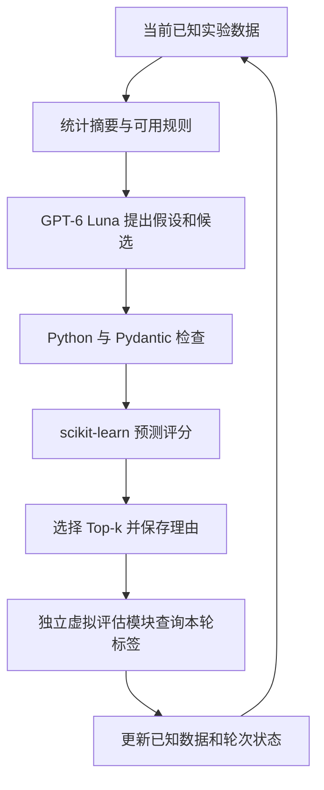

# 蛋白质定向进化智能体：技术栈调研与选型

调研日期：2026-11-08 至 2026-11-09（北京时间）。

本方案依据笔试试题、用户确认的运行条件、论文、软件官方文档及包发布信息制定。确定的是首轮实现所采用的组件与比较方法；模型优劣、接口能力和联合运行兼容性分别通过后续实验确认。

## 1. 已确定的运行条件与决策原则

- 首轮实验在当前 Windows 电脑运行。只读检查得到：i9-14900HX，24 核 32 线程，约 95.7 GiB 内存，RTX 5090 Laptop GPU，显存 24,463 MiB，驱动 621.14。
- 本机现有 Python 为 3.12.14。Harness 环境已有 NumPy 2.3.5、pandas 3.0.1、python-docx 1.2.0；本次检查未发现 SciPy、scikit-learn、Pydantic、OpenAI SDK、Matplotlib 和 pytest。
- 用户确认拥有独立项目可用 API，并指定 OpenAI / GPT-6 Luna。项目采用这一模型条件；该模型实际接口的能力通过专门检查确认。
- 每一项技术决策须先联网调研，记录来源、替代方案、选择理由和待验证条件。文档支持某项功能与本机实际运行通过是两种不同状态。
- 所有性能比较使用同一实验条件；预测器的最终选择取决于验证集结果和资源消耗。

## 2. 首轮实现技术栈

| 层次 | 确定采用的组件或方法 | 对本项目的作用与选择理由 | 依据 |
| --- | --- | --- | --- |
| 运行环境 | Windows + CPython 3.12.14 | 使用已存在的解释器作为首轮验证目标；选定库的发布信息提供 Python 3.12 支持依据 | 本机检查、[S12]、[S13] |
| 环境隔离 | 项目独立 venv + pip，测试后固定完整依赖版本 | 标准库提供隔离环境，便于说明安装过程；不修改 Harness 的共享环境 | [S12]、[S14] |
| 数据任务 | GB1 四个位点的 IgG-Fc 结合选择相关 fitness | 有明确的四位点组合空间及公开测量数据，适合检查组合突变和多轮反馈 | [S01]、[S02] |
| 数据入口 | Wu et al. 2016 的 Supplementary file 1 | 官方单文件入口明确；与单独发布的缺失值插补表区分，便于建立有实验依据的虚拟评估器 | [S02]、[S03] |
| 数据读取与处理 | pandas + NumPy + openpyxl | 源数据为 XLSX；读取、清洗、分组和数值处理都可在同一 Python 程序完成 | [S15]、[S16] |
| 序列表示 | 四个实验位点的 one-hot；同时保存完整 GB1 域序列 | 固定二十种标准氨基酸时得到 80 个特征；位点与特征可对应检查 | [S01]、[S07] |
| 适应度模型 | scikit-learn：Ridge、RandomForestRegressor、ExtraTreesRegressor | 同一库提供线性模型与两类树集成，统一训练、预测及比较接口，胜出配置由验证集确定 | [S08]、[S09]、[S10] |
| 评估 | SciPy + scikit-learn metrics / Pipeline | Spearman、Pearson、MSE、数据划分及预处理；另计算定义清楚的 Top-k 和逐轮指标 | [S11]、[S17]、[S18] |
| LLM 接入 | 官方 OpenAI Python SDK + 用户指定 GPT-6 Luna | SDK 提供 Responses 与 Chat Completions、异常处理和请求信息；实际端点能力单独验证 | [S19] |
| Agent 流程 | Python 显式轮次调度 + 本地工具函数 + Pydantic | 完成六项 Agent 功能，明确每一步输入输出和数据可见范围 | 项目要求、[S19]、[S20] |
| 知识增强 | 带来源和适用范围的 JSON 规则库，Pydantic 校验 | 支持氨基酸性质、替换偏好、突变数量和已知实验规律；便于启用/关闭进行比较 | 项目要求、[S20] |
| 数据与运行记录 | CSV 表格、JSON 配置/轮次状态、JSONL 事件日志 | 单机顺序实验可直接查看和交换结果，嵌套的模型调用信息逐条保存 | [S21]、[S22] |
| 模型保存 | joblib，并记录完整依赖版本 | 保存本项目训练的预测器供重复评分；加载环境与训练环境保持一致 | [S23] |
| 图表与报告 | Matplotlib；python-docx 制作报告，再导出 PDF | 生成结果曲线和表格，交付题目规定的 3—5 页报告 | [S24]、[S25]、[S26] |
| 测试与入口 | pytest + 标准库 argparse | 测试数据与流程逻辑，通过明确命令运行数据处理、训练和实验 | [S27]、[S28] |
| 代码交付 | Git + GitHub，README 记录环境、数据与命令 | 满足代码链接和小规模复现要求 | 项目要求、[S29] |

软件组件已经选定。实际数据记录、API 调用和模型训练尚未运行；补丁版本需在独立环境联合验证后固定。

## 3. 数据集比较与 GB1 获取方案

### 3.1 已比较的任务

| 候选 | 已核实的任务特点 | 本项目的取舍 |
| --- | --- | --- |
| GB1 / Wu 2016 | 四个位点 V39、D40、G41、V54，理论空间 20⁴；公开 profile 表与插补表分别发布；存在突变相互作用 | 采用为首个任务，原因是搜索范围明确，组合突变与隐藏反馈都容易定义 |
| GFP / Sarkisyan 2016 | 测量 GFP 荧光，包含数万种衍生基因型；核苷酸记录与氨基酸记录需要区分 | 保留为扩展任务；切换时需重新核对评分标度、序列合并及候选覆盖 |
| AAV / Bryant 2021 等 | 不同研究涉及包装可行性、组织分布等不同目标；设计区域及序列处理方式有差异 | 当前选择单一 GB1 结合任务；若研究目标改为 AAV，再针对具体 assay 选数据 |

GFP 与 AAV 的来源见 [S05]、[S06]。

### 3.2 明确的数据入口

采用 [eLife Supplementary file 1][S03]，官方标题为 *The fitness of each profiled variant*。官方 API 元数据同时把 Supplementary file 2 标为 *Imputed fitness values for missing variants*。[S02]

本项目的虚拟评估标签取自 S1；S2 的预测插补值不混入实验反馈。原文报告能够计算 fitness 的记录为 149,361 / 160,000，另外 10,639 个缺失值另行插补。这是论文报告的数量，本项目清洗后的行数须读取文件后统计。[S01]

还需记录一个测量来源细节：论文对部分单点突变采用先前实验的高覆盖数据并做校准。因此应把 S1 描述为已测变体及相关实验校准数据，保存原表分数及其处理说明。

实施时依次完成：

1. 获取 S1，记录 DOI、文件版本、下载日期、表名和字段含义。
2. 确认野生型、四位点字符串、fitness、缺失值和重复记录；把分数为 0 的记录与缺失值分开处理。
3. 采用原文的 56 aa GB1 结构域作为展示与候选还原的序列范围，核对完整参考序列和局部编号；四个位点的参考字母为 `VDGV`。
4. 保留完整域序列、突变列表和四位点编码之间的双向检查。
5. 仅把 S1 中具有有效实验分数的合法记录纳入可查询候选池。

FLIP 与 ProteinGym 的 GB1 数据都来源于该实验，属于同一实验的不同整理版本。序列形式也不同：FLIP 关联的 5LDE chain A 包含融合构建，ProteinGym 使用全长参考序列。局部编号、结构域序列和全长编号要明确区分。[S04]

## 4. 预测模型的选择方法

### 4.1 首轮比较集合

- **Ridge + one-hot：**检验线性加和关系能够解释多少变化；系数可对应位点类别。它不能表达未加入特征的非线性交互。[S08]
- **Random Forest + one-hot：**检验树模型对非线性及条件关系的拟合。树数量、深度与叶样本约束需通过验证和内存检查确定。[S09]
- **Extra Trees + one-hot：**在同一编码和划分下检查不同随机化树策略的效果。[S10]

三者先使用相同的已知数据和预先声明的验证规则。按验证集 Spearman 与高分候选识别结果选择用于主要 Agent 对照的预测器，同时报告 Pearson、MSE、运行时间和内存。各指标可能出现取舍，应保留完整比较结果。

超参数搜索范围、训练规模、Top-k 的 k、随机种子数量和每轮生成预算在读取数据并完成小规模计时后确定，形成配置后再开展正式比较。最终保留测试集不用于这些选择。

### 4.2 其他已调研候选

| 候选 | 文档支持的能力 | 加入实验前需要解决的问题 |
| --- | --- | --- |
| XGBoost | 支持 CPU hist、GPU 和 scikit-learn 接口，可用验证集早停 | 增加依赖；Windows 运行库及 CPU/GPU 版本需验证，早停数据不能使用最终测试集 |
| Gaussian Process | 可预测均值与标准差，便于研究不确定性选择 | 标准实现对样本规模与高维特征有扩展性限制，核与噪声设置需验证 |
| ESM 表示 + 回归器 | 可抽取预训练的残基或序列表示 | 选择型号、表示层与池化方式；验证 PyTorch、Windows、Blackwell GPU 兼容性、时间和显存 |

这些候选的依据分别为 [S30]、[S31]、[S32]。它们的准确度收益要用本任务实验判断。首轮选择 one-hot 是为了先建立位置可解释、依赖明确的比较；后续增加表示或模型时，沿用同一数据划分进行评价。

现有 RTX 5090 Laptop 可用于 GPU 实验；PyTorch/CUDA 的前向计算仍需实际验证。NVIDIA 的 RTX 50 系列支持说明提供了兼容检查起点。[S33]

## 5. Agent、知识规则与模型接口

### 5.1 当前确定的实现

采用一个 Python 程序掌握实验轮次，GPT-6 Luna 负责数据解释、假设与候选建议。本地函数负责合法性检查、适应度预测、推荐排序和结果记录。模型的自然语言输出不直接充当工具计算结果。

建议的功能划分为：

1. **数据分析：**读取当前已知实验结果和 top variants，计算可提供给 LLM 的统计摘要。
2. **假设形成：**总结可能有益的位点及其依据，保留待验证的组合假设。
3. **候选设计：**输出结构化突变建议，由 Python 还原候选序列。
4. **模型评分：**校验位点、字母、重复项与可查询范围，再调用预测器。
5. **推荐与解释：**按已声明的规则选择 Top-k，给出与已知数据、规则和预测相符的理由。
6. **反馈更新：**由独立评估模块返回本轮结果，加入已知数据，进入下一轮。

这实现六项必需功能。Pydantic 负责字段、类型和范围校验；生物学正确性与序列一致性仍由专门的检查函数处理。[S20]

### 5.2 OpenAI / GPT-6 Luna 的接入状态

模型选择由用户明确指定。官方 Python SDK 同时提供 Responses 与 Chat Completions，文档把 Responses 作为主要接口，并支持配置端点、超时、重试和请求信息。[S19]

确定使用官方 SDK；实际采用哪种端点，依据项目服务配置与一次接口能力检查确定。需检查：API 中使用的精确 model 标识、普通响应、工具调用参数、工具结果回传、结构化输出、拒绝或截断结果，以及 usage 字段。

GPT-6 Luna 的专属工具调用与严格 JSON Schema 能力，本次尚未完成公开正文及项目接口的双重确认；实验记录按实际验证结果描述。若端点支持原生工具调用，则用工具调用循环；若只提供文本或 JSON，则由应用解析经过 Pydantic 检查的行动请求，再执行本地工具。所用方式在实验记录中固定。

重试仅针对可重试请求错误；本地评估与写入根据轮次和候选记录去重，避免请求重试导致重复获取标签。每次实验记录调用量与返回 usage；在获得实际价格规则前只报告请求数与tokens。

### 5.3 与编排框架的比较

LangChain 提供预制的模型与工具循环。[S36] LangGraph 提供显式状态与持久化，并支持故障恢复处理。[S34]、[S37] 当前任务是单机、有限轮次、少量工具，直接函数调度能明确展示每步的数据和职责，因此首轮采用该方式。

若后续需要复杂分支、人工介入、长时间中断恢复或多个并行研究流程，再重新比较 LangGraph 等工具。当前方案中的本地轮次状态与日志仍需实现。

### 5.4 知识库内容和存储

JSON 规则条目至少保存规则编号、适用蛋白任务、条件、操作、来源和说明；Pydantic 检查其结构。氨基酸性质引用可核资料，历史突变规律只从当前已知实验数据生成。

所有方法共享基本序列合法性检查。知识增强实验额外启用用于选择和解释的规则，以便比较知识带来的变化。知识图谱和语义检索在出现明确的关系查询或文献检索需求后再选型；题目允许直接使用小型规则库。

## 6. 数据可见范围与四种方法比较

数据使用四个角色：初始已知训练数据、模型选择用验证数据、可查询但标签隐藏的候选池、始终保留的最终测试数据。它们按序列及必要的重复测量组分开；需要学习的预处理步骤仅在训练数据拟合。[S11]

已查询的候选可以用于下一轮训练，未查询的标签继续隐藏；最终测试部分不提供给 Agent、模型选择或知识规则生成。虚拟评估标签来自 S1，预测分数和评估分数分别保存。

虚拟进化至少需要 2—3 轮迭代，首轮实施计划采用 3 轮。初始数据与后续推荐轮次分别编号。随机突变、模型直接推荐、LLM Agent、知识增强 LLM Agent使用同一初始数据、允许序列范围、推荐数、轮数和标签查询预算；模型的训练与更新方法保持一致，各方法仅使用自己的反馈历史。

评估至少覆盖排序、数值误差和推荐结果：Spearman、Pearson、MSE；定义清楚的 Top-k 命中率；逐轮平均/最高 fitness、累计最佳值、重复率、模型评分次数与 LLM usage。对不同随机种子的变化进行报告。相关指标的定义来源为 [S17]、[S18]；具体实验配置在小规模试运行后冻结。

## 7. 工程组织、环境与版本

### 7.1 环境管理的比较结果

标准 venv 提供独立环境；uv 的 pip 兼容路线也能解析并同步固定版本，锁文件格式与工具选择相互独立。[S12]、[S14]

本项目首轮选择 venv + pip，原因是可以使用已有 Python、减少需要另外维护的工具，并便于初学者理解安装过程。先在独立环境解析和验证依赖，再记录完整的直接与传递依赖版本。遵守工作区规则，不执行显式校验和生成或核对，不创建含校验和的锁文件。

### 7.2 联合验证候选版本

下列是调研时观察到的版本候选，供环境验证使用；最终版本以联合验证结果为准。

| 包 | 候选版本 | 发布信息中的 Python 前提或当前状态 |
| --- | --- | --- |
| NumPy | 2.5.4 | Python ≥3.12；本机共享环境现有 2.3.5 |
| pandas | 3.1.1 | Python ≥3.11；本机共享环境现有 3.0.1 |
| SciPy | 1.18.1 | Python ≥3.12 |
| scikit-learn | 1.9.1 | Python ≥3.11；已核对 CPython 3.12 Windows x64 wheel 发布信息 |
| Pydantic | 2.14.3 | Python ≥3.10 |
| OpenAI SDK | 3.46.0 | Python ≥3.10 |
| Matplotlib | 3.11.2 | Python ≥3.11 |
| pytest | 9.2.0 | Python ≥3.10 |
| openpyxl / joblib | 依 XLSX 读取与 sklearn 依赖要求解析 | 联合验证后固定补丁版本 |
| python-docx | 1.2.0 | 本机已有且已用于教材生成；项目独立环境仍需记录 |

发布信息见文末的 PyPI 链接。软件包的最低 Python 要求相容；传递依赖在安装阶段通过联合验证后固定。安装阶段需完成依赖解析、导入、数据读取、模型训练预测、schema 检查与图表导出，再确定最终固定版本。

### 7.3 文件记录与交付

CSV 保存规范化数据与结果表，JSON 保存配置和轮次状态，JSONL 保存模型与工具事件。当前单机顺序实验采用文件记录；若后续需要并发写入、事务或频繁关系查询，再考虑 SQLite。[S21]、[S22]、[S35]

joblib 仅加载本项目生成的可信模型文件，随模型保存 Python、scikit-learn 和相关依赖版本；官方文档不保证跨版本加载。[S23]

Matplotlib 输出图表；python-docx 组织正式报告，再通过文档导出工具生成 PDF 并检查页数和排版。README 说明数据获取、环境、运行命令及主要结果，代码通过 GitHub 交付。[S24]—[S29]

首轮入口采用命令行。网页 demo 属可选交互扩展，待实验流程完整后根据实际交互需求另行联网选型。当前没有选择前端框架、Web 服务或部署平台。

## 8. 实施前与实施中的验证事项

1. 读取 S1，核对表头、有效行、野生型、四位点和完整域序列，保存实验校准说明。
2. 在独立环境验证选定库的共同安装与运行，固定依赖版本。
3. 通过用户已有 API 验证 GPT-6 Luna 的实际模型标识、端点、工具或结构化输出方式与 usage。
4. 对相同数据划分运行三种预测器，记录准确度、推荐表现及资源消耗，确定主要实验使用的预测器与参数。
5. 确定训练规模、k、候选生成预算和重复次数，再运行三轮及四方法比较。
6. 检查隐藏标签不可见、候选合法性、序列去重、分数对应、失败响应与轮次保存；使用 pytest 固定关键行为。
7. 从清晰的运行命令重现实验，完成图表、失败案例和题目规定的交付物。

### 交付内容检查

- 3—5 页 PDF 报告覆盖：背景与问题定义、数据集介绍、适应度预测模型、LLM Agent 设计、知识增强方法、虚拟定向进化实验结果、失败案例分析、改进建议与未来拓展。
- 展示野生型与若干完整突变序列、每轮 Top-k、fitness 表格或曲线，解释重要位点、氨基酸替换、组合选择和失败原因。
- 结合四种方法的结果和过程记录，讨论 Agent 是否体现假设形成、检验和反馈改进等科学研究能力，以及相对直接调用预测模型的具体贡献。
- GitHub 代码包含数据处理、训练、Agent 推理、候选生成和评估；README 写明环境、数据来源、命令和主要结果。
- 在报告中说明使用的外部数据、模型、代码及 ChatGPT 等辅助工具的来源和使用方式。

本轮完成的是调研与选型，没有安装项目依赖、下载完整实验表、发送项目 API 请求或训练预测器；上述事项为实现验证步骤。

## 9. 主要来源

- [S01] Wu et al. (2016), *Adaptation in protein fitness landscapes is facilitated by indirect paths*，eLife 原始研究；位点、测量、校准与缺失值处理。
- [S02] eLife 官方文章 API；S1/S2 的文件标题、版本与地址。
- [S03] S1 官方 XLSX 单文件入口。
- [S04] FLIP GB1 README、RCSB 5LDE FASTA、ProteinGym reference metadata；序列形式与数据同源关系。
- [S05] Sarkisyan et al. (2016), *Local fitness landscape of the green fluorescent protein*。
- [S06] Bryant et al. (2021), *Deep diversification of an AAV capsid protein by machine learning*。
- [S07] scikit-learn OneHotEncoder。
- [S08] Ridge；[S09] RandomForestRegressor；[S10] ExtraTreesRegressor。
- [S11] scikit-learn 数据泄漏与预处理说明。
- [S12] Python venv；[S13] scikit-learn 发布信息；[S14] uv 依赖编译与同步。
- [S15] pandas read_excel；[S16] pandas read_csv。
- [S17] SciPy spearmanr / pearsonr；[S18] scikit-learn MSE。
- [S19] OpenAI Python SDK 官方 README；[S20] Pydantic JSON Schema。
- [S21] Python CSV；[S22] JSON Lines 格式说明。
- [S23] scikit-learn 模型持久化。
- [S24] Matplotlib savefig；[S25] python-docx；[S26] LibreOffice PDF 导出。
- [S27] pytest 入门；[S28] argparse；[S29] GitHub 仓库入门。
- [S30] XGBoost sklearn 接口；[S31] sklearn Gaussian Process；[S32] FAIR ESM README。
- [S33] NVIDIA RTX 50 系列软件支持说明。
- [S34] LangGraph 持久化；[S35] Python SQLite。

[S01]: https://pmc.ncbi.nlm.nih.gov/articles/PMC4985287/
[S02]: https://api.elifesciences.org/articles/16965
[S03]: https://cdn.elifesciences.org/articles/16965/elife-16965-supp1-v4.xlsx
[S04]: https://github.com/J-SNACKKB/FLIP/blob/main/splits/gb1/README.md
[S05]: https://www.nature.com/articles/nature17995
[S06]: https://www.nature.com/articles/s41587-020-00793-4
[S07]: https://scikit-learn.org/stable/modules/generated/sklearn.preprocessing.OneHotEncoder.html
[S08]: https://scikit-learn.org/stable/modules/generated/sklearn.linear_model.Ridge.html
[S09]: https://scikit-learn.org/stable/modules/generated/sklearn.ensemble.RandomForestRegressor.html
[S10]: https://scikit-learn.org/stable/modules/generated/sklearn.ensemble.ExtraTreesRegressor.html
[S11]: https://scikit-learn.org/stable/common_pitfalls.html
[S12]: https://docs.python.org/3.13/library/venv.html
[S13]: https://pypi.org/project/scikit-learn/1.9.1/
[S14]: https://docs.astral.sh/uv/pip/compile/
[S15]: https://pandas.pydata.org/docs/reference/api/pandas.read_excel.html
[S16]: https://pandas.pydata.org/docs/reference/api/pandas.read_csv.html
[S17]: https://docs.scipy.org/doc/scipy/reference/generated/scipy.stats.spearmanr.html
[S18]: https://scikit-learn.org/stable/modules/generated/sklearn.metrics.mean_squared_error.html
[S19]: https://raw.githubusercontent.com/openai/openai-python/main/README.md
[S20]: https://pydantic.dev/docs/validation/latest/concepts/json_schema/
[S21]: https://docs.python.org/3.13/library/csv.html
[S22]: https://jsonlines.org/
[S23]: https://scikit-learn.org/stable/model_persistence.html
[S24]: https://matplotlib.org/stable/api/_as_gen/matplotlib.pyplot.savefig.html
[S25]: https://python-docx.readthedocs.io/en/latest/
[S26]: https://help.libreoffice.org/latest/en-US/text/shared/01/ref_pdf_export.html?dbpar=writer&system=win
[S27]: https://docs.pytest.org/en/stable/getting-started.html
[S28]: https://docs.python.org/3.13/library/argparse.html
[S29]: https://docs.github.com/en/repositories/creating-and-managing-repositories/quickstart-for-repositories
[S30]: https://xgboost.readthedocs.io/en/stable/python/sklearn_estimator.html
[S31]: https://scikit-learn.org/stable/modules/gaussian_process.html
[S32]: https://github.com/facebookresearch/esm
[S33]: https://developer.nvidia.com/blog/new-ai-sdks-and-tools-released-for-nvidia-blackwell-geforce-rtx-50-series-gpus/
[S34]: https://docs.langchain.com/oss/python/langgraph/persistence
[S35]: https://docs.python.org/3/library/sqlite3.html
[S36]: https://docs.langchain.com/oss/python/langchain/agents
[S37]: https://docs.langchain.com/oss/python/langgraph/fault-tolerance

### 补充的直接来源

- [RCSB 5LDE FASTA](https://www.rcsb.org/fasta/entry/5lde/display)
- [ProteinGym assay 元数据](https://raw.githubusercontent.com/OATML-Markslab/ProteinGym/main/reference_files/DMS_substitutions.csv)
- [ProteinGym README](https://raw.githubusercontent.com/OATML-Markslab/ProteinGym/main/README.md)
- [SciPy pearsonr](https://docs.scipy.org/doc/scipy/reference/generated/scipy.stats.pearsonr.html)
- [LangChain Agents](https://docs.langchain.com/oss/python/langchain/agents)
- [LangGraph fault tolerance](https://docs.langchain.com/oss/python/langgraph/fault-tolerance)
- [Joblib persistence](https://joblib.readthedocs.io/en/latest/user_guide/persistence.html)
- PyPI 版本候选：[NumPy 2.5.4](https://pypi.org/project/numpy/2.5.4/)、[pandas 3.1.1](https://pypi.org/project/pandas/3.1.1/)、[SciPy 1.18.1](https://pypi.org/project/scipy/1.18.1/)、[Pydantic 2.14.3](https://pypi.org/project/pydantic/2.14.3/)、[OpenAI 3.46.0](https://pypi.org/project/openai/3.46.0/)、[Matplotlib 3.11.2](https://pypi.org/project/matplotlib/3.11.2/)、[pytest 9.2.0](https://pypi.org/project/pytest/9.2.0/)。
