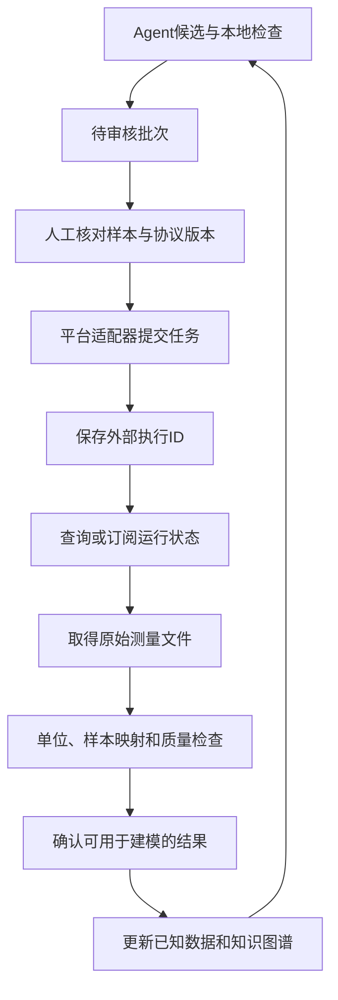

# 科学智能体与自动化实验平台的对接讨论

本文件讨论当前虚拟系统怎样连接真实自动化实验平台，依据公开软件接口给出任务提交、执行、结果与质量检查的设计。

## 1. 当前系统与外部平台的职责

当前Agent输出候选变体、假设和选择理由；预测器提供估计分数，虚拟评估器返回S1中已有的测量结果。连接真实平台后，候选设计和模型训练仍在本项目中完成，评估结果的获取改为经过任务提交、设备执行、结果导入和质量检查的异步过程。

平台适配器负责转换数据格式和任务状态。设备只能执行其实际支持、已由实验人员验证的协议；LLM输出不能直接成为任意设备命令。

## 2. 两类公开接口的参考价值

### SiLA 2

SiLA 2采用Feature、Command和Property描述设备能力，以HTTP/2、gRPC和Protocol Buffers传输。客户端应读取服务器实际声明的Feature，不能假定所有仪器都提供相同的命令。[1]

SiLA Python的Observable Command返回执行实例及 `execution_uuid`，支持查询状态、进度、估计剩余时间，以及获得最终或中间响应。官方状态包含waiting、running、finishedSuccessfully、finishedWithError；输入验证错误、执行错误和连接错误可分别处理。[2]

对本项目的作用是：把一个已审核实验批次映射到明确的外部执行实例，等待实际结果后再进入下一轮。具体的实验能力和参数映射仍需针对设备Feature实现。

### Opentrons

Opentrons提供机器人软件的HTTP API及OpenAPI参考，包含运行创建与查询、命令、运行错误、暂停和恢复、协议分析，以及数据文件访问等能力。请求使用API版本信息；Protocol Python API的 `apiLevel` 与机器人软件版本也需要区分。[3,4]

官方读板模块文档展示了从协议运行取得CSV数据的方式，属于特定模块和实验功能；[5] 导出文件的内容由具体assay决定，数据解析、归一化和质量要求均由assay定义。

本项目可先把这些接口作为适配器边界参考。选择具体设备之前，还需要确认其实际模块、已验证协议、接口版本和可获得的测量字段。

## 3. 本项目需要定义的数据记录

### 待提交批次

| 字段 | 用途 |
| --- | --- |
| schema_version | 本项目任务格式版本 |
| experiment_id、batch_id | 关联研究和候选批次 |
| operation_id | 标识一次提交意图，防止重复创建任务 |
| variant_id、sequence、mutations | 确定候选身份，并与样本记录对应 |
| assay_id | 明确要测量的性质和适用条件 |
| protocol_id、protocol_version | 引用已审核协议 |
| model_version、prompt_version | 记录候选产生方式 |
| approval_status、approved_by | 记录批次是否已经审核 |

设备布局、样品准备和协议参数由具体平台及实验人员确定，不能仅由四字母变体标识推断。内部候选ID必须与外部样本ID建立唯一映射。

### 测量回传

| 字段 | 用途 |
| --- | --- |
| external_execution_id | 对应SiLA执行UUID或平台run ID |
| batch_id、variant_id、sample_id | 把测量对应回正确候选 |
| replicate_id | 区分重复测量 |
| raw_value、unit | 保存原始数值及明确单位 |
| assay_id、instrument_id、protocol_version | 保存测量条件来源 |
| raw_file_location | 指向原始文件记录 |
| qc_status、qc_reasons | 标记是否满足预先定义的质量要求 |
| fitness、normalization_version | 保存可用于本任务建模的分数与计算版本 |
| recorded_at、accepted_at | 区分采集时间和接受为建模数据的时间 |

fitness的定义由assay决定。例如本项目S1的相对选择分数不能直接与仪器吸光度混用。原始值和转换后分数分开保留，转换规则需有来源和版本。

## 4. 任务状态与异常处理

建议内部状态包括：待审核、已审核、提交中、已受理、运行中、暂停、成功、失败、取消及结果未知。适配器把外部状态映射到这些明确状态，并保存原始外部状态和执行ID。

- **提交超时：**平台可能已接受任务。先使用已取得的外部执行ID查询；若没有收到ID，且平台支持按内部批次标记检索，则核查匹配任务。无法确定时标记为结果未知并人工核对，不盲目再次提交。
- **查询失败：**采用有限次数、带间隔的状态查询重试，保留最后成功状态与错误信息。
- **设备执行失败：**保留错误类型和中间结果，不把任务失败转换为蛋白质fitness为0。
- **部分样本失败：**逐样本记录质量状态，不能把缺失值补成生物学低分。
- **重复回传：**依据外部执行ID、样本ID、重复编号和数据版本检查重复记录；对冲突结果明确标记，不静默覆盖。
- **协议或单位变化：**暂停自动合并，由适配器与实验人员确认是否可比较，必要时建立独立assay。

已查阅的公开接口没有提供可以对所有平台统一依赖的提交幂等机制。因此内部operation_id、唯一性检查和外部执行ID记录仍由项目适配器负责，不能仅靠一次HTTP重试保证设备只执行一次。

## 5. 质量检查与下一轮更新

只有满足预先定义质量要求、样本映射正确并被接受的结果，才能进入下一轮已知数据。需要检查至少以下内容：

1. 批次、候选和样本映射是否完整且唯一。
2. 数值、单位、assay和协议版本是否一致。
3. 缺失、异常和重复测量是否按预先规则处理。
4. 控制样本和重复测量是否满足该实验的质量要求。
5. 原始文件及计算过程是否可查阅。

API参数验证不等于实验质量验证。SiLA的ValidationError或Opentrons的运行错误处理，不能替代本项目对测量结果的检查。

被接受的测量新增到对应方法的训练数据和知识图谱Measurement节点；未通过检查的记录保留为失败信息，但不作为有效fitness训练标签。之后重新训练预测器、更新不确定性，再产生新批次。

## 6. 从软件模拟到实际连接的分阶段验证

可先使用模拟适配器测试以下软件行为：重复提交、状态映射、超时结果未知、部分样本失败、单位不符、重复回传以及数据映射。模拟结果必须明确标注，不能混入真实实验性能表。

正式连接前，依次确认接口连通性、只读设备信息、协议版本兼容、人工审核与受控任务执行，最后核对结果文件与候选的完整映射。每一步均依赖具体设备和已验证协议，不由本讨论自动授权执行。

**本阶段交付状态：**已完成公开接口调研、系统职责、数据字段、状态与异常、质量检查和更新流程的讨论。未安装平台驱动、连接仪器、提交设备任务或开展湿实验。

## 参考资料

[1] SiLA标准概览：https://sila-standard.com/standards/

[2] SiLA Python客户端及Observable Command：

- https://sila2.gitlab.io/sila_python/content/client/usage.html
- https://sila2.gitlab.io/sila_python/content/api/client/client_observable_command.html
- https://sila2.gitlab.io/sila_python/content/api/framework/command_execution_status.html

[3] Opentrons HTTP API：https://docs.opentrons.com/http/api_reference.html

[4] Opentrons Protocol API版本：https://docs.opentrons.com/python-api/versioning/

[5] Opentrons读板结果：https://docs.opentrons.com/absorbance-plate-reader/data/

[6] Opentrons labware版本与单位：https://docs.opentrons.com/flex/labware/definitions/
